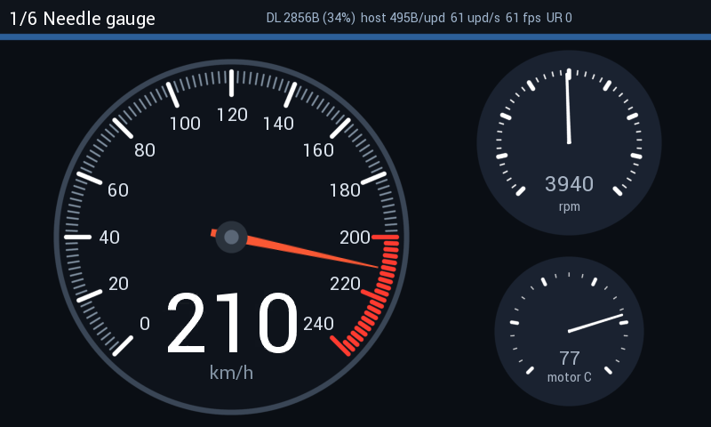

# BT817 GUI Benchmark (800x480) / BT817 GUI 对比测试程序

This example runs six 800x480 GUI scenes on the BT817 emulator and measures, for
every frame, what the host has to send and how full the display list gets. The
same six scenes are specified below for a framebuffer controller such as the
Levetop LT7689, so both chips can be compared on identical screens. The LT7689
section is a proposed hardware test plan, not a measured comparison.

本示例在 BT817 仿真器上运行 6 个 800x480 GUI 场景，逐帧统计主控需要发送的字节数和
Display List 占用率。下文给出同样 6 个场景在帧缓冲型控制器（如 Levetop LT7689）上的
等效测试规格，以便在相同界面上对比两种架构。

## Scenes / 场景

| # | Scene / 场景 | What it stresses / 测试要点 |
|---|---|---|
| 1 | Needle gauge / 指针仪表 | Bilinear rotation of an anti-aliased needle every frame, dial cached with `CMD_NEWLIST`, ROM font 34 readout, two `CMD_GAUGE` widgets / 每帧双线性旋转抗锯齿指针，表盘用 `CMD_NEWLIST` 缓存 |
| 2 | Page transitions / 页面切换 | Two full pages compiled once into RAM_G; slide with `VERTEX_TRANSLATE_X`, fade through black / 两页预编译进 RAM_G，滑动与淡入淡出 |
| 3 | Kinetic list / 惯性列表 | 50 rows, fling scrolling, ASTC icon read directly from flash and scaled 0.25x per row / 50 行惯性滚动，图标为 Flash 中的 ASTC 实时缩放 |
| 4 | Dense text / 密集文本 | About 1,000 anti-aliased glyphs re-sent every frame, live values, ticker / 每帧约 1000 个抗锯齿字符 |
| 5 | History chart / 曲线图 | `LINE_STRIP` with 250 / 500 / 1000 / 1500 points over a cached grid / 250–1500 点抗锯齿折线 |
| 6 | 30 static pages / 30 页静态画面 | Page flip every 0.5 s; ASTC image in flash scaled 2x / 每 0.5 秒翻页，图片为 Flash 中 ASTC 放大 2 倍 |

The top bar shows the live numbers: display-list bytes and percentage of the 8 KB
limit, host bytes per update, update rate, display frame rate and `REG_UNDERRUN`.

顶部状态栏实时显示：Display List 字节数及占 8 KB 上限的百分比、每次刷新主控发送字节数、
刷新率、显示帧率和 `REG_UNDERRUN`。

## Build and run / 编译与运行

Requires Windows x64, CMake 3.15 or newer, and Visual Studio 2022 with C++
build tools. From this directory, run:

```powershell
cmake -S . -B build -G "Visual Studio 17 2022" -A x64
cmake --build build --config Release
```

The build copies `bt8xxemu.dll`, `btflashemu.dll`, `libz.dll`, and the shared
`../Flash/flash-817-default.bin` beside the executable. The Flash image holds
the ASTC picture used in scenes 3 and 6. Keep these files together when moving
the executable.

| Option | Behavior |
|---|---|
| No options | Run all six scenes in a window for 6 seconds each. |
| `--seconds N` | Set each timed scene to `N` seconds (minimum 1). |
| `--interactive` | Stay on a scene until PREV or NEXT is selected; close the window to stop. Cannot be combined with `--capture`. |
| `--capture DIR` | Run without a window and write one BMP capture per scene to `DIR`. |
| `--csv FILE` | Write results to `FILE` instead of `benchmark_results.csv` in the current directory. |

Run the benchmark in any of these modes:

```powershell
.\build\bin\Release\BT817Benchmark.exe                    # window, 6 s per scene
.\build\bin\Release\BT817Benchmark.exe --interactive      # PREV / NEXT buttons
.\build\bin\Release\BT817Benchmark.exe --capture shots    # headless, one BMP per scene
.\build\bin\Release\BT817Benchmark.exe --seconds 10 --csv results.csv
```

The program prints a summary and writes the CSV after the run. `--capture`
creates BMP files; the PNGs in `sample_output/` are bundled reference images,
not the capture format produced by the executable.

程序结束后会打印结果表并写入 CSV。`--capture` 生成 BMP 文件；
`sample_output/` 中的 PNG 是参考图片，不是程序直接生成的格式。

The code is split so it can move to a real board: `eve_hal.cpp` holds the only
four transport functions (chip select, byte transfer, running), and `scenes.cpp`
and `eve_cmd.h` do not depend on the emulator. On hardware, replace those four
functions with the board's SPI driver and use a hardware timer for the clock.

代码已为移植到真实硬件做好分层：仅 `eve_hal.cpp` 中 4 个传输函数依赖仿真器，
`scenes.cpp` 和 `eve_cmd.h` 与仿真器无关。移植时把这 4 个函数换成板上 SPI 驱动即可。

## Emulator results / 仿真结果

The bundled [`sample_output/benchmark_results.csv`](sample_output/benchmark_results.csv)
is one example run, not a performance baseline. The program disables dynamic
degrade and uses an 800x480 display with `REG_PCLK` set to 2. Host bytes count
SPI write transactions, including address bytes, but exclude reads and status
polling. `max_dl_bytes` is compared with the 8 KiB display-list capacity.

| Scene | Host bytes / update | Max DL bytes | DL % of 8 KiB |
|---|---:|---:|---:|
| Needle gauge | 495 | 2,856 | 35% |
| Page transitions | 280 | 4,420 | 54% |
| Kinetic list | 1,271 | 3,588 | 44% |
| Dense text | 1,979 | 6,492 | 79% |
| History chart | 3,548 | 6,932 | 85% |
| 30 static pages | 775 | 2,372 | 29% |

For reference, one full 800x480 16bpp frame is 768,000 bytes.



**What these numbers mean / 结果解读**

- These scenes send 280 to 3,548 write bytes per update, versus 768,000 bytes
  for a full 16bpp framebuffer. 这些场景每次刷新发送 280 至 3,548 字节；完整
  16bpp 帧为 768,000 字节。
- Dense text reaches 79% of the display-list capacity, and the history chart
  reaches 85% in this run. 密集文本和曲线图分别占用 Display List 的 79% 和 85%。
- Cached content and ASTC assets read by EVE from Flash reduce host writes in
  several scenes. 缓存内容及 EVE 直接读取 Flash 中的 ASTC 资源可减少主控写入量。

**Limits of the emulator / 仿真器的局限**

The write-byte counts describe this program's emulator transport calls. They
do not include reads, MCU work, or physical SPI timing. Update rate, display
frame rate, and `REG_UNDERRUN` are host-dependent emulator observations; measure
them on BT817 hardware before drawing conclusions about frame rate or render
budget.

写入字节数仅统计本程序向仿真器发送的数据，不包含读取、MCU 工作量或实际 SPI 时序。
刷新率、显示帧率和 underrun 受主机环境影响，必须在 BT817 硬件上实测。

## Equivalent test on LT7689 / LT7689 等效测试规格

Run the same six screens on an LT7689 board at 800x480, 16bpp, with the same
host MCU and SPI clock as the BT817 board. For each scene record the same
columns: host bytes per update, achieved update rate, visible tearing, and MCU
CPU load.

在 LT7689 板上以 800x480、16bpp、相同主控 MCU 和 SPI 时钟运行相同 6 个画面，
记录同样指标：每次刷新主控字节数、实际刷新率、是否撕裂、MCU 占用率。

The implementations and bottlenecks below are hypotheses to test on hardware;
this repository does not include LT7689 measurements.

| # | LT7689 implementation / 实现方式 | Expected bottleneck / 预期瓶颈 |
|---|---|---|
| 1 | Dial pre-drawn in SDRAM; each frame BTE-copy the dial area, then draw the needle. LT7689 rotates only by 90/180 degrees, so the needle is either pre-rendered at N angles (memory) or drawn by the MCU as a polygon without anti-aliasing / 表盘预存，指针需预渲染多角度或 MCU 画无抗锯齿多边形 | Needle smoothness and MCU load / 指针平滑度与 MCU 负载 |
| 2 | Both pages pre-rendered in SDRAM; slide by BTE move or by changing the display window start address; fade with BTE alpha blend / 两页预存，BTE 搬移或改显示起始地址 | Alpha fade across 800x480 at 60 fps / 全屏 alpha 渐变带宽 |
| 3 | Icons pre-scaled and stored in SDRAM; scroll with BTE move plus redraw of the newly exposed rows / 图标预缩放，BTE 滚动 + 补绘新行 | Text redraw for new rows / 新行文本补绘 |
| 4 | Text drawn by the internal font engine or MCU-rendered anti-aliased fonts sent over SPI / 内置字库或 MCU 渲染抗锯齿字体 | Anti-aliased text cost / 抗锯齿文本开销 |
| 5 | Line drawn with the geometry engine (no anti-aliasing) or by the MCU / 几何引擎画线（无抗锯齿）| Visual quality at 1500 points / 1500 点画质 |
| 6 | 30 pages stored in external flash, copied into SDRAM by DMA on each flip / 30 页存 Flash，翻页时 DMA 到 SDRAM | Flip latency and flash size / 翻页延迟与 Flash 容量 |

Expected outcome: LT7689 should match or beat BT817 on scene 6 (no display list
limit, pages are just memory copies) and possibly scene 4 for very dense
screens; BT817 should be ahead on scenes 1, 3 and 5 where rotation, scaling and
anti-aliasing are needed every frame. Scene 2 depends on how fast LT7689's BTE
alpha blend runs at full screen. The hardware runs decide this, not the
emulator.

预期：场景 6（无 DL 上限，翻页即内存拷贝）及极密文本场景 LT7689 可能持平或更优；
场景 1、3、5（每帧需要旋转、缩放、抗锯齿）BT817 应占优；场景 2 取决于 LT7689 BTE
全屏 alpha 混合速度。最终以硬件实测为准。

## Files / 文件

| File | Purpose |
|---|---|
| `main.cpp` | Emulator setup, panel timing, scene loop, HUD, capture, CSV |
| `eve_hal.h/.cpp` | SPI transport, register access, command FIFO, fault recovery |
| `eve_cmd.h` | Display list encoders and coprocessor command builder |
| `scenes.h/.cpp` | The six scenes |
| `CMakeLists.txt` | Windows x64 build, copies DLLs and the flash image |
| `sample_output/` | Reference PNGs and an example results CSV |
